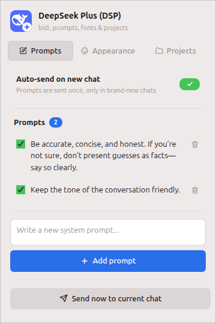
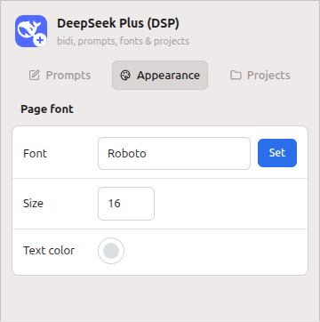
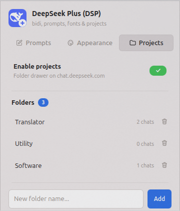
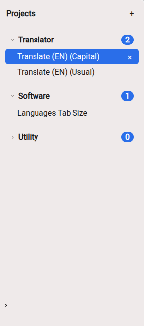

<div align="center">


# DeepSeek Plus (DSP)

A Chrome extension (Manifest V3) that upgrades **chat.deepseek.com** with
automatic RTL/LTR text direction, reusable system prompts, full control
over the page font, a wider chat column, project folders and
auto-collapsed thinking sections.


</div>

> [!NOTE]
> Unofficial companion extension — not affiliated with DeepSeek.

## Screenshots

|            System prompts            |               Page font               |
| :----------------------------------: | :-----------------------------------: |
|  |          |
|             **Projects**             |          **Projects drawer**          |
|      |  |

## Features

### 1. Automatic text direction (bidi)

- The direction of every paragraph is derived from its first strong
  character, so Persian, English and mixed conversations all render
  correctly.
- Code blocks and inline code are always kept LTR.
- Implemented purely in CSS with `unicode-bidi: plaintext` — no DOM
  scanning, no observers, zero runtime cost.

### 2. System prompts

- Store any number of prompts, each with an on/off toggle.
- **Auto mode** (default): all active prompts are combined into a single
  message and sent **exactly once per brand-new chat**. A chat counts as
  new while it has no rendered messages — any chat with content
  (opened from history, in a new tab, after a reload) is never touched.
- **Manual mode**: turn "Auto-send on new chat" off and use the
  **"Send now to current chat"** button to insert the prompts yourself,
  as many times as you like, in any chat.

### 3. Appearance (page font)

One general setting applied to the entire page:

| Setting    | Effect                                       |
| ---------- | -------------------------------------------- |
| Font       | Any family from Google Fonts; default Roboto |
| Size       | Font size in px (9–48); default 16           |
| Text color | Font color; unset = site default             |

How fonts work:

1. Start typing a family name in the font field — matches from the
   bundled Google Fonts catalog appear in realtime; pick one (or type a
   name manually and press Enter / Set).
2. The stylesheet is fetched from the Google Fonts CSS2 API, every
   referenced woff2 file is downloaded and embedded as a data URI.
3. The embedded CSS is cached in the extension's local browser storage
   (`chrome.storage.local`) and injected only into DeepSeek pages.
4. On every page load the cache is checked; if a font is missing (for
   example after storage was cleared) it is downloaded again
   automatically.

Changes apply live on all open DeepSeek tabs.

### 4. Projects (chat folders)

DeepSeek has no folder organization, so the extension adds one —
without touching the native left sidebar:

- Enable it in the popup's **Projects** tab (applies instantly).
- A fixed **Projects drawer** appears on the RIGHT side of the page with
  your folders; it can be collapsed to a slim tab and back.
- Create folders with the **+** button (drawer or popup), then **drag
  chats from the native history list and drop them onto a folder**.
- Click a chat inside a folder to open it (normal SPA navigation); the ×
  on a chat removes it from the folder. The native left sidebar keeps
  showing every chat unchanged.
- Folder rename/delete is done from the popup's Projects tab (deleting
  a folder frees its chats).

Storage: the folder tree, chat assignments and cached chat titles live in
`chrome.storage.local` — the extension's own browser storage. It was
chosen over IndexedDB because the data is a few kilobytes, and
`storage.onChanged` syncs every open DeepSeek tab and the popup
instantly. No cookies and no page-owned storage (localStorage) are used.

### 5. Wider conversation column

The chat column is 25% wider: the extension reads DeepSeek's own
`--message-list-max-width` value and overrides it proportionally, so it
keeps working if the site changes its default.

### 6. Ayu Mirage code theme

All code snippets in chats are re-themed with the Ayu Mirage palette
(MIT licensed): a `#242835` block surface with the signature token
colors — green strings, yellow functions, blue classes, cyan tags,
orange keywords, faded-blue italic comments. Applied to both of
DeepSeek's dark and light code-block variants via `theme-ayu.css`.

### 7. Collapsed thinking sections

DeepSeek keeps every "Thought for ..." reasoning block expanded, so long
thinking pushes the actual answer off screen. The extension collapses
each block automatically:

- Blocks are collapsed as soon as they appear: while an answer is still
  streaming, when an older chat is opened and after a reload. The
  response stays in view by default.
- A block is collapsed at most once: if you expand it again, it stays
  open.
- Detection uses DeepSeek's own expand/collapse ARIA state
  (`aria-expanded` / `aria-controls`) as a fallback alongside the
  current class names, so it keeps working when the site renames its
  hashed CSS classes.

## Permissions & privacy

- **Site access**: the content script is injected only into
  `https://*.deepseek.com/*` — the domain and all of its subdomains, over
  HTTPS only. This is enforced by Chrome's match-pattern mechanism; the
  extension has **no access and no host permissions for any other site**.
- **Storage**: the only requested permission is `storage`, used to keep
  prompts, settings and cached fonts on the user's machine.
- **Network**: the only outbound requests are font downloads from
  `fonts.googleapis.com` and `fonts.gstatic.com`. Nothing else is sent
  anywhere; there is no analytics, tracking or remote code.

## Installation

1. Open `chrome://extensions`.
2. Enable **Developer mode** (top right).
3. Click **Load unpacked** and select this folder.

## Build & packaging

### With the script (recommended)

```bash
./pack.sh
```

Creates in `dist/`:

| Artifact                         | Purpose                                   |
| -------------------------------- | ----------------------------------------- |
| `deepseek-plus-v<version>.zip`   | Portable build to share or upload.        |
| `deepseek-plus-v<version>.crx`   | Signed package like Chrome's pack button. |
| `dist/deepseek-plus-v<version>/` | Clean copy for manual GUI packing.        |

The zip is the file to hand out: unzip it, open `chrome://extensions`,
enable Developer mode, click **Load unpacked** and select the extracted
folder — it is also the exact format accepted by the Chrome Web Store.
The `.crx` is produced only when a Chrome/Chromium binary is found. The
staging folder is kept after the run for packing through Chrome's GUI.

> [!TIP]
> Prefer the zip for manual sharing: modern Chrome installs off-store
> `.crx` files only through enterprise policy.

> [!WARNING]
> On its first run the script also writes **`extension-key.pem`** in the
> project root and reuses it for every later build. Keep it private and
> never lose it: updates must be signed with the same key to keep the
> same extension ID. The key and the `dist/` folder must never be
> committed to version control (`.gitignore` already excludes both).

### With Chrome's GUI (Pack extension)

1. Run `./pack.sh` once to create the clean staging folder (packing the
   project root directly would include repo-only files such as this
   README, `.gitignore` and `.editorconfig`).
2. Open `chrome://extensions` → **Pack extension**.
3. Extension root directory: `dist/deepseek-plus-v<version>`.
4. Private key field: empty on the very first build (Chrome creates a
   `.pem` — store it as `extension-key.pem`); select that key file on
   every later build.
5. Click **Pack** — the `.crx` and key are written next to the folder.

## File structure

| File            | Purpose                                                             |
| --------------- | ------------------------------------------------------------------- |
| `manifest.json` | Extension metadata, permissions, content scripts                    |
| `content.js`    | Prompt auto-send, page typography, wider column, collapsed thinking |
| `projects.js`   | Projects drawer: folders, drag & drop, live sync                    |
| `fonts.js`      | Shared Google Fonts downloader/cacher                               |
| `fonts.json`    | Google Fonts catalog snapshot for autocomplete                      |
| `styles.css`    | Bidi direction rules for DeepSeek pages                             |
| `theme-ayu.css` | Ayu Mirage color theme for code snippets                            |
| `popup.html`    | Toolbar popup UI (flat theme)                                       |
| `popup.js`      | Popup logic: prompts, theme, font search                            |
| `icons/`        | Extension icons (16/32/48/128 px)                                   |
| `assets/`       | Logo SVG used by this README                                        |
| `pack.sh`       | Build script: `.zip` and signed `.crx` in `dist/`                   |
| `.editorconfig` | Repo lint rules: line length, whitespace, indentation               |

## Storage keys

| Key                | Content                                                |
| ------------------ | ------------------------------------------------------ |
| `prompts`          | Array of `{ text, active }`                            |
| `autoSend`         | `true` = auto mode, `false` = manual mode              |
| `projects`         | `{ enabled, collapsed, folders, assignments, titles }` |
| `theme`            | `{ chatFont, chatSize, chatColor }`                    |
| `uiTab`            | Last active popup tab                                  |
| `fontCss:<family>` | Embedded Google Fonts CSS, cached per family           |

## Changelog

### 1.24.1

- Hardened the site-coupled selectors against DeepSeek redesigns. The
  "conversation is visible" check now also matches the markdown body
  and user bubble classes next to `.ds-message`, so a class rename can
  no longer make an open chat look brand-new to the auto-send.
- The Ayu code theme gained a fallback route: if the site renames its
  `.md-code-block` wrappers, the block surface and code text are still
  themed through the markdown container's `pre` elements.

<details>
<summary>Earlier releases</summary>

### 1.24.0

- Thinking sections now start collapsed: every "Thought for ..." block
  is collapsed the moment it appears, whether the answer is still
  streaming, the chat was opened from history or the page was reloaded.
  Long reasoning no longer pushes the answer off screen.
- A block is collapsed at most once: anything you expand yourself stays
  open.
- Detection uses the site's own ARIA state (`aria-expanded` /
  `aria-controls` pointing at the reasoning content) as a fallback
  alongside the current class names, so it keeps working when DeepSeek
  renames its hashed classes.

### 1.23.0

- Added the Ayu Mirage code theme (`theme-ayu.css`): every code
  snippet in chats is recolored with the Ayu Mirage palette, mapped
  onto DeepSeek's Prism token classes. Applies to both the site's dark
  and light code-block variants.

### 1.22.4

- Default page font size raised from 15px to 16px.

### 1.22.3

- Collapse handle redesigned: a slim 22x72px edge tab with a clean SVG
  chevron icon (no text glyphs), hugging the drawer's left edge so it
  no longer covers folder rows; direction flips with the state and it
  remains fully visible in the collapsed sliver. Folder chevrons also
  switched from text characters to the same SVG icon.

### 1.22.2

- Collapse/expand handle doubled in size (60x176px, 40px chevron) and
  left-aligned so the chevron stays visible in the collapsed sliver.

### 1.22.1

- Hairline separators (same style as the popup) added between the
  Projects drawer folders and under its header, and the collapse/
  expand handle enlarged and refined (30x88px, larger chevron, hover
  fill).

### 1.22.0

- The right-side Projects drawer restyled to match the popup's flat
  design: single flat surface with a hairline edge instead of shadows
  and borders, flat hover-fill rows, sentence-case header, blue count
  pills, full-width blue selection for the active chat, and a blue
  ring highlight for drop targets. Adapts to the site's dark and light
  themes with the same token structure.

### 1.21.0

- Renamed the project to **DeepSeek Plus (DSP)** across the manifest,
  popup, build script and docs; build artifacts are now named
  `deepseek-plus-v<version>`. Added an unofficial-affiliation note.

### 1.20.3

- Popup corners squared off: only the faint black outline remains, no
  border radius.
- Removed the usage-hint banner from the Projects tab.
- The Page font settings rebuilt: a white panel with
  hairline-separated rows (Font / Size / Text color) with left-aligned
  labels and right-aligned controls, replacing the old banner card.

### 1.20.2

- Fixed the rounded popup corners: backgrounds set on `html`/`body`
  propagate to the canvas and paint the full rectangle, which made the
  corners look cut. The canvas is now fully transparent and all popup
  visuals (background, faint outline, radius) moved to an inner frame
  element, so the popup window corners are genuinely rounded.

### 1.20.1

- Popup framed with a faint dark outline (1px rgba black) and rounded
  12px corners — Chrome renders extension popup windows with transparent
  corners, so the rounding applies to the window itself.

### 1.20.0

- New branding: the extension and popup icons are now the DeepSeek whale
  mark in white on the DeepSeek blue (#4D6BFE) squircle with a white
  "plus" badge — a DeepSeek Plus identity for the extension.
- Confirmed the bundled Google Fonts catalog snapshot is current
  (1950 families).

### 1.19.2

- Grouping refined: top-level groups are now divided by subtle 1px
  hairline separators, group headers are semibold sentence case (no
  more uppercase micro-labels), the appearance panel and usage hint
  became borderless filled banners, count badges are blue pills with
  white numbers, and toggles switched to a green rounded pill with a
  white checkmark. Accent and status colors: #1E6FE8 / #34C759.

### 1.19.1

- Repository hygiene for publication: removed the unused embedded-fonts
  stylesheet, corrected the file-structure and storage-key tables,
  hardened `.gitignore` (OS/editor junk).

### 1.19.0

- Popup restyled with a flat design: a single warm-gray surface
  (#ECEAE6) with no shadows or gradients, list rows separated by
  spacing alone with a light hover fill, white bordered fields, a flat
  toolbar-style tab control, saturated selection blue (#1873FF), green
  toggles and checkboxes (#2FD44E) and the system font. Element
  structure and functionality unchanged.

### 1.18.0

- The floating-widget reservation now shifts DeepSeek's whole
  `.ds-floating-container` layer instead of individual widgets. The
  layer clips its overflowing children (`overflow:hidden`), so the
  peek/tuck hover behavior of the chat-section navigation works
  relative to the drawer's edge — the tucked sliver always stays
  hoverable next to the drawer instead of disappearing under it.
  Floating widgets NOT anchored at the right edge (centered toasts)
  are detected and compensated back to their original spot.

### 1.17.0

- Right-side space reservation rebuilt into DeepSeek's own
  CSS: the Share button and the chat-section navigation live in
  `.ds-floating-container` overlays as `.ds-floating-position-wrapper`
  elements that the site positions via transforms (which the previous
  detector wrongly skipped). They are now targeted by class and shifted
  with the independent `translate` CSS property, which composes with
  their transform-based positioning instead of breaking it; a generic
  right-edge sweep catches any other fixed point widgets the same way.
  The page itself still never moves.

### 1.16.0

- Right-side space reservation reworked to a targeted approach: the
  page itself no longer moves at all. Instead, the extension samples
  the viewport's right edge with elementsFromPoint, auto-detects the
  site's right-pinned fixed widgets (the Share button, the section
  navigation menu) and slides just those left of the drawer via an
  element-level translate (open: full width, collapsed: the 26px
  sliver), in sync with the drawer animation. Guards: only fixed
  elements, no pre-existing transforms, and point widgets (not
  full-width bars) are shifted. Disabling restores everything.

### 1.15.2

- Reverted the 1.15.1 transform experiment: applying a transform to the
  app roots broke the site's own fixed-position overlays and stacking
  (dropdowns, tooltips, composer). Space reservation is back to the
  stable margin-only approach.

### 1.15.1

- Space reservation for the Projects drawer now also shifts the site's
  position:fixed elements: the app roots get a static transform in
  addition to the right margin, which turns them into the containing
  block for fixed descendants (DeepSeek uses many), so nothing overlaps
  the drawer in either state.

### 1.15.0

- Popup restyled to a neumorphic (soft UI) design with a blue accent:
  soft blue-gray canvas (#E7ECF5), white gradient cards with blue-gray
  shadows, blue gradient primary pills and toggle tracks with white
  knobs, separate squircle tab cards (active = stronger card + blue
  icon), clean underline inputs, and blue focus rings. Element
  structure and functionality unchanged.

### 1.14.1

- Default page font size raised from 13px to 15px.

### 1.14.0

- The conversation column is now 25% wider: DeepSeek's own
  `--message-list-max-width` value is read at runtime and overridden
  proportionally (with retries while the app's styles load, and a guard
  that prevents compounding on re-runs).

### 1.13.1

- Toggle switches (auto-send, enable projects) now show a dark knob in
  the primary-button color when ON, making the state obvious at a
  glance; OFF keeps the neutral neumorphic look.

### 1.13.0

- Popup restyled to a neumorphism (soft UI) design: a single light-gray
  surface shaped purely by paired light/dark shadows — raised cards,
  pill rows and buttons, pressed-in inputs, tracks and icon wells,
  large radii and a monochrome palette, with Poppins embedded locally
  as the UI font. All functionality and element structure unchanged.

### 1.12.0

- The Projects drawer now reserves space on the page: the app's root
  containers get a right margin matching the drawer state (full width
  or the collapsed sliver) with the same transition, so right-side
  content slides along with the drawer instead of being overlapped —
  in both the open and collapsed states.
- Drawer width increased by ~25% (232px → 290px).
- Drawer typography unified with the global page font: all fixed font
  sizes/families in the drawer CSS were removed, so folder names, chat
  rows and labels follow the Page font setting exactly like the rest
  of the site.

### 1.11.0

- Font settings simplified to a single **Page font** section (family,
  size, optional text color) applied to the whole page. All separate
  code/snippet typography settings were removed; stored leftovers are
  purged automatically. Defaults: Roboto, size 13, color unset.
- The native left sidebar is no longer modified in any way. Projects
  moved to a new fixed drawer on the RIGHT side of the page with the
  same folder behavior: drag chats from the native history list and
  drop them onto folders, click a chat to open it (SPA), remove with ×,
  collapse the drawer to a slim tab. Folder rename/delete remains in
  the popup's Projects tab.
- Fixed a popup crash introduced with the code-font removal (a leftover
  reference to a deleted input broke the whole popup, disabling every
  control including the Projects toggle).

### 1.10.0

- Sidebar sections rebuilt: **Projects** (custom folders, drag & drop) at
  the top, then DeepSeek's own **Pinned** block kept completely native
  (no styling, multiselect button intact) directly below it, then a
  history section where chats that are neither pinned nor filed are
  grouped into collapsible folder cards named after DeepSeek's own date
  labels (Today / Yesterday / ...). The original date list is hidden and
  mirrored; no app DOM node is moved. Clear separator lines divide the
  three sections.
- Typography defaults: the general font now defaults to **Roboto 13px**
  (applied everywhere except code/snippets) and the code font to
  **Fira Code 13px** (applied only to code and snippets). Both are
  downloaded from Google Fonts and cached like any custom pick.
- Theme rules now carry high-specificity selectors so they also win
  against the site's own `!important` font declarations (previously the
  general font/size did not affect parts of the UI such as the injected
  sidebar folders).

### 1.9.0

- Restructured the sidebar layout: **Projects** on top, DeepSeek's own
  **Pinned** section right below it, then the remaining chats grouped by
  DeepSeek's own date labels (Today / Yesterday / ... exactly as the site
  renders them) as collapsible folder-like cards. Sections are divided by
  clear separator lines; date groups collapse with a click and their
  state persists. No app DOM nodes are moved — only styling and classes
  are applied, so React keeps working underneath.
- The popup now preserves the full `projects` storage object when
  writing, so page-managed keys (collapsed date groups, cached titles)
  survive edits made from the popup.

### 1.8.1

- The sidebar panel no longer shows a delete button next to folders and no
  longer displays the drag hint line; folders are managed (renamed and
  deleted) exclusively from the extension's Projects tab.

### 1.8.0

- Added Projects / chat folders: a third popup tab with an instant
  enable/disable toggle and folder management, plus an injected Projects
  panel on the DeepSeek sidebar supporting drag-and-drop of chats into
  folders. Stored in `chrome.storage.local` and synced live across tabs.

### 1.7.0

- Popup and toolbar icons restyled.

### 1.6.0

- New-chat detection rewritten around the DOM instead of navigation
  events: DeepSeek's "new chat" is a pure UI state, so a debounced
  MutationObserver now watches for the composer-with-no-messages state
  and triggers there. The prompts are inserted into the input box first,
  and only then is send triggered (with a verification retry that leaves
  the text in the box for a manual send if the app refuses it).
- Safety rails: auto-send never fires on `/a/chat/s/...` URLs (existing
  chats), never while the user is already typing, and never overwrites
  typed text. The manual "Send now" button still replaces and sends.
- Added `pack.sh` and a "Build & packaging" section: one command builds
  the distributable zip and a signed crx (Chrome GUI packing documented
  as well).

### 1.5.0

- Removed the background-color pickers from both appearance cards — they
  conflicted with the site's own colors (e.g. code syntax highlighting).
  Stored background settings are purged automatically.
- Auto-send reliability fixes: stale per-tab state no longer blocks
  sending after reloads, the send button is only clicked when actually
  enabled, and new-chat detection relies solely on `.ds-message`
  elements so the welcome screen can never be mistaken for a message.

### 1.4.0

- Chat typography (font, size, text color) now applies to the **whole
  DeepSeek page**; the chat background color paints the page background
  (`html`/`body`). Code settings still target code blocks only and
  override the page-wide styling there.
- New-chat detection is now content-based: a chat containing any rendered
  message counts as existing; an empty chat counts as new and receives
  the prompts once. Replaces the URL-pattern heuristic.
- The manual "Send now to current chat" button moved into the Prompts
  tab (no longer shown while on the Appearance tab).

### 1.3.0

- Fixed theme styling not applying: every CSS declaration now carries its
  own `!important`, and the selectors target DeepSeek's real DOM classes
  (`.ds-markdown`, `.ds-user-message`, `.md-code-block`, the chat input).
- All appearance settings (font, size, text color, background) now apply
  live on the page the moment they change.
- Font fields have realtime autocomplete backed by a bundled snapshot of
  the Google Fonts catalog (`fonts.json`, 1950 families sorted by
  popularity). Picking a suggestion downloads and applies the font
  immediately. No extra permissions required.
- Popup reorganized into tabs: **Prompts** and **Appearance**; the
  "Send now to current chat" button stays in the always-visible footer.
- All active prompts are combined into a single message (joined with a
  blank line) — auto-send and manual send both send one message.

### 1.2.0

- Restricted the extension strictly to `https://*.deepseek.com/*`
  (domain + subdomains, HTTPS only, no host permissions anywhere else).
- Auto-send now fires only for **brand-new chats**, exactly once per chat;
  existing chats (including opened in new tabs) are never touched.
- Manual mode: "Send now to current chat" works in any chat, repeatedly.
- Added Appearance settings: Google-Fonts-backed font family, size, text
  color and background color for both chat text and code blocks, with
  local caching and live updates.

### 1.1.0

- Removed the `<all_urls>` match pattern and `host_permissions`.
- Direction handling moved fully to CSS (`unicode-bidi: plaintext`);
  removed the page-wide MutationObserver and URL polling.
- Redesigned the popup with a modern UI, dark-mode support and icons.

### 1.0.0

- Initial release: bidi direction, system prompt auto-send, basic popup.

</details>
